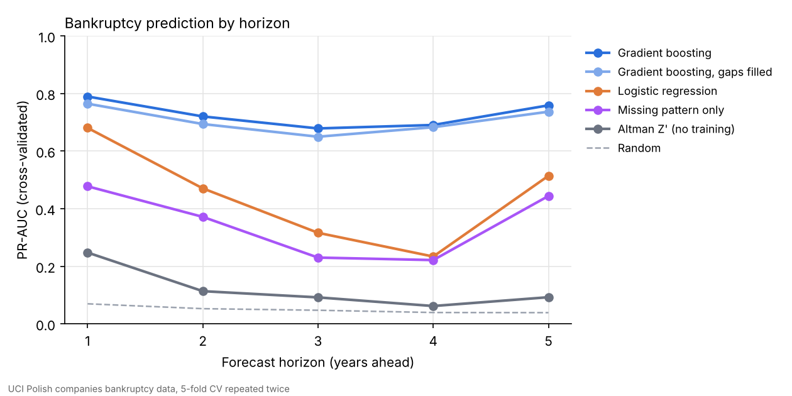

# Bankruptcy Prediction for Polish Companies

Can a model warn a lender that a company will go bankrupt, one to five years before it happens, and how much better is it than a classic finance score?

I work on credit risk data in my internship, and my other project ([UK SME Financial Health](https://github.com/hanchenzhang32-byte/uk-sme-financial-health)) only has balance sheet data. This dataset also has profit and loss ratios and real bankruptcy outcomes, so I used it to test models properly against a finance baseline and to check how far the results can be trusted.

## Data

[Polish companies bankruptcy data](https://archive.ics.uci.edu/dataset/365/polish+companies+bankruptcy+data) from the UCI Machine Learning Repository (CC BY 4.0). 43,405 rows of 64 financial ratios for Polish companies, 2000 to 2013. Five files, one per horizon: ratios from one year and whether the company was bankrupt 1, 2, 3, 4 or 5 years later. Only 3.9% to 6.9% of rows are bankrupt.

Download the zip from the link above and put the five `.arff` files in `data/raw/`.

## How to run

```sh
pip install -r requirements.txt
./run.sh
```

| File | What it does |
| --- | --- |
| `scripts/load_data.py` | Reads the ARFF files, checks duplicates, missing and infinite values, writes one CSV |
| `scripts/train.py` | Compares models at each horizon, then looks closely at the 1 year horizon |

## Data checks before modelling

- **401 duplicate rows** (identical ratios and label in the same file). Left in, they could sit in both the training and test folds and inflate the scores, so they are removed.
- **54% of rows have a missing value.** Missing values are not random: sales growth (X21) is missing for 24.8% of companies that went bankrupt and almost never for the rest. A model given only *which* values are missing reaches PR-AUC 0.48 at the 1 year horizon (random is 0.07). That is a sign of how the data was collected, not of real financial health, so I also train a version that fills every gap with the median and cannot see the pattern.
- **Possible leakage.** X24 is described as gross profit "in 3 years" over total assets. If that means future profit, it would not be known at prediction time, so it is left out. Adding it back raises test PR-AUC only slightly (0.759 to 0.772).

## Models

- **Altman Z' score** for private firms, with the published 1983 weights and no training. This is the classic finance benchmark.
- **Logistic regression** with median filling, missing value flags, rank scaling and class weights.
- **Gradient boosting** (scikit-learn `HistGradientBoostingClassifier`), which handles missing values and extreme ratios itself.

Only 4% to 7% of companies go bankrupt, so accuracy is not useful. I report PR-AUC and the share of bankruptcies caught in the 10% the model ranks as riskiest. Scores are from 5-fold cross-validation repeated twice.

## Results



| Horizon | Random | Altman Z' | Logistic regression | Gradient boosting | Gradient boosting, gaps filled |
| --- | --- | --- | --- | --- | --- |
| 1 year | 0.069 | 0.248 | 0.681 | **0.790** | 0.765 |
| 2 years | 0.053 | 0.114 | 0.471 | **0.720** | 0.694 |
| 3 years | 0.047 | 0.092 | 0.316 | **0.679** | 0.650 |
| 4 years | 0.039 | 0.062 | 0.234 | **0.691** | 0.683 |
| 5 years | 0.039 | 0.093 | 0.514 | **0.759** | 0.737 |

PR-AUC, cross-validated. Full results in `results/by_horizon.csv`.

**1 year horizon, held-out test set** (1,463 companies, 102 bankrupt):

- Gradient boosting: PR-AUC 0.759, ROC-AUC 0.948, catches 74.5% of bankruptcies in the riskiest 10%. Altman Z' catches 38.2%.
- Probabilities are usable: Brier score 0.031, against 0.065 for always predicting the average rate (`results/calibration_1y.csv`).
- **Decision threshold.** If missing a bankruptcy costs 10 times a false alarm, the usual 0.5 cut-off is a poor choice: it catches 59 of 102 and misses 43. A threshold picked on the training folds (about 0.03) catches 86 and misses 16, at the price of 130 false alarms, and cuts the total cost from 445 to 290.
- Most useful ratios (permutation importance): operating profit over financial expenses (interest cover), sales growth, and operating expenses over total liabilities (`results/importance_1y.csv`).

## What I learned

- Gradient boosting beats the Altman score at every horizon by a wide margin, and beats logistic regression most at longer horizons, where the links between ratios and failure are less linear.
- Most of the model's power is real: filling the gaps costs only 0.01 to 0.03 PR-AUC. But the missing value pattern on its own is strongly predictive, which would be a warning sign in production.
- The threshold matters as much as the model. Choosing it from the cost of each kind of mistake changes the number of missed bankruptcies far more than switching models.

## Limitations

- There are no company IDs or years, so the same company may appear in several files and splits cannot be made by company or by time. Scores here are likely higher than a lender would see on new companies in a later year.
- The five horizons are different samples, so the scores are not a clean curve over time (the 5 year horizon scores higher than the 3 year one).
- Polish companies from 2000 to 2013 may not behave like UK SMEs today.
